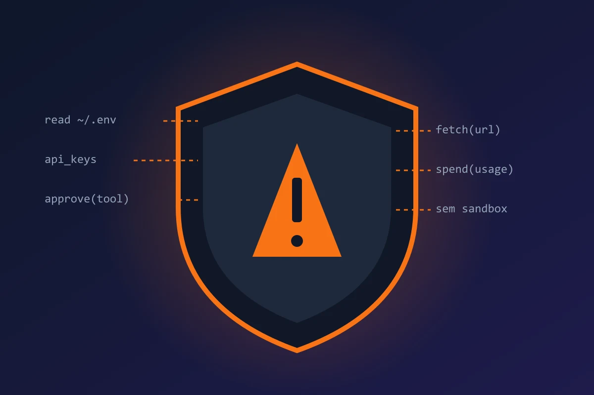
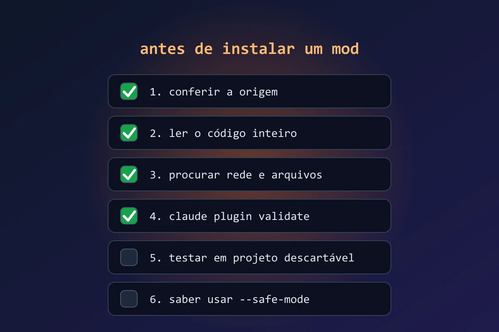

Hasta esta semana, cambiar el comportamiento de Claude Code significaba tocar archivos de configuración, escribir scripts de shell y esperar que existiera el evento adecuado. El 1 de octubre de 2026, Anthropic abrió otra puerta: los **mods**, pequeñas funciones en TypeScript que se enganchan a los eventos internos del agente y cambian lo que hace.

La idea es simple de explicar y grande en sus consecuencias. Claude Code deja de ser solo una herramienta que usas y pasa a ser una herramienta que programas. Este artículo explica qué son los mods, qué pueden hacer, cómo empezar y, sobre todo, por qué tienes que tratar cada mod como un programa instalado en tu máquina.

## Qué son los mods

Según el [anuncio oficial de Anthropic](https://claude.com/blog/claude-code-mods), un mod puede reescribir un prompt, añadir una interfaz nueva, reemplazar una función integrada o crear una funcionalidad entera. Funcionan enganchándose a eventos que Claude Code emite mientras trabaja, y se pueden apilar varios mods, que se ejecutan en el orden en que fueron cargados.

En la práctica, un solo mod puede:

- **Reescribir el prompt** antes de que llegue al modelo.
- **Bloquear, reescribir o repetir** una llamada a una herramienta.
- **Aprobar o denegar** solicitudes de permiso.
- **Ocultar secretos** que aparecerían en la salida de una herramienta.
- **Editar la interfaz**, incluidos paneles junto a la conversación, franjas sobre el prompt y botones.

Otro punto que llama la atención: la propia Anthropic convirtió en mods tres funciones que ya eran del producto, el panel de diff, el cargador de `agents.md` y la telemetría. Eso indica que el sistema es infraestructura de verdad, y no un experimento de fin de semana.

## Cómo instalarlos y dónde funcionan

Los mods viajan dentro de plugins, así que la instalación sigue el flujo que ya conoces. Según la [cobertura de Cellcog](https://cellcog.ai/blog/claude-code-mods/), los requisitos son:

- Claude Code en la versión **2.1.287 o superior**.
- Instalación con el comando `/plugin install nombre@marketplace` y recarga con `/reload-plugins`.
- Soporte en la **terminal** y en la pestaña **Code de la app de escritorio**. En otros entornos, no.

En las versiones compatibles los mods ya vienen activados por defecto, sin ningún flag extra. Si prefieres no escribir nada, Anthropic dice que también puedes pedirle a Claude que genere el mod, lo instale y lo recargue en la misma sesión.

## Qué se puede construir

Los ejemplos más útiles para el día a día de quien programa son los que automatizan disciplina que solemos olvidar:

1. **Filtro de secretos.** Un mod que revisa la salida de las herramientas y borra claves de API y tokens antes de que el modelo los vea.
2. **Guardia de comandos peligrosos.** Un mod que bloquea `rm -rf`, `git push --force` o cualquier comando que nunca quieres que el agente ejecute solo.
3. **Estandarizador de prompts.** Un mod que añade a tu pedido las reglas del proyecto, como el estilo de código y las carpetas prohibidas, sin que tengas que repetirlo todo el tiempo.
4. **Panel propio.** Un panel junto a la conversación que muestre el costo de la sesión, los archivos tocados o el plan en curso.

Si quieres probar sin escribir código, pídeselo a Claude. Un prompt de partida:

  

    
    ejemplo
    <button class="copy-btn" data-copy-target="mod-prompt">Copiar</button>
  

  <pre id="mod-prompt"><code>Crea un mod para Claude Code que oculte los secretos en la salida
de las herramientas. Debe reemplazar por [OCULTO] cualquier valor
que parezca una clave de API, un token o una contraseña en
variables de entorno y archivos .env.

Antes de instalarlo, muestra el código completo y explica, línea
por línea, qué archivos y variables lee el mod y si hace alguna
llamada de red. Instálalo solo después de que yo lo apruebe.</code></pre>

La última frase es la parte importante. Quieres ver el código antes de que exista en tu máquina, incluso cuando fue el propio Claude quien lo escribió.

## El riesgo: un mod es código con tus permisos

Este es el punto que no puede pasar desapercibido. La documentación de Anthropic es directa: los mods se ejecutan con el mismo acceso a tu máquina que el propio Claude Code, no están en un sandbox, y solo debes instalar mods de fuentes en las que confíes.

Según [Cellcog](https://cellcog.ai/blog/claude-code-mods/), un mod cargado puede leer y escribir archivos en cualquier lugar al que llegue tu cuenta, acceder a variables de entorno y claves de API, ver cada prompt y cada llamada a una herramienta, aprobar llamadas automáticamente y gastar tu uso de la API. La única barrera que se mantiene firme es que un mod no puede alterar la propia pantalla de solicitud de permiso, aunque sí puede preaprobar llamadas.

Para quien sigue el tema de seguridad en agentes de código, esto suena conocido. Es el mismo tipo de riesgo de cadena de suministro que tratamos en el artículo sobre [seguridad de MCP en agentes de código](/mcp-seguridad-agentes-de-codigo): una extensión aparentemente útil, instalada con un comando, gana un acceso amplio a tu entorno. La diferencia es que aquí la extensión vive dentro del agente, en el punto exacto en que se toman las decisiones.

### Controles que ofrece Anthropic

- `claude plugin validate` para inspeccionar un mod antes de instalarlo.
- `--safe-mode` para desactivar todos los mods en una sesión.
- `disableAllHooks` para desactivarlos todos de forma global.
- En los planes **Team y Enterprise**, un mod integrado llamado `sec-default` se carga primero e impide acciones riesgosas, como pasar por encima de una denegación de permiso. Los administradores pueden leer su código y restringir qué mods se cargan.

## Checklist de 6 pasos antes de instalar un mod

Este es el proceso mínimo que seguiría antes de instalar cualquier mod que no escribí yo:

1. **Revisa el origen.** Prefiere mods del directorio oficial o de autores que puedas identificar. Un enlace aleatorio de una red social no cuenta.
2. **Lee todo el código.** Un mod útil suele tener unas pocas decenas de líneas. Si tiene cientos y no lo entiendes, no lo instales.
3. **Busca red y archivos.** Cualquier `fetch`, envío a una URL externa o lectura de `~/.ssh`, `.env` y similares es una señal roja.
4. **Ejecuta `claude plugin validate`** y solo después instala.
5. **Prueba en un proyecto descartable** antes de usarlo en el repositorio de trabajo o en una máquina con credenciales de producción.
6. **Sabe cómo desactivarlo.** Memoriza `--safe-mode` antes de necesitarlo.

## Cuidado con el material descoordinado

Como el lanzamiento es muy reciente, ya circulan guías de terceros con detalles distintos entre sí, como nombres de eventos y flags de activación que no aparecen en el anuncio oficial. Trata esos detalles con cuidado y confirma en la documentación de Anthropic antes de copiar código de un blog, incluido este. En este artículo usé solo lo que aparece en el anuncio oficial y en las coberturas que lo confirman.

## Qué llevarte de aquí

Los mods convierten a Claude Code en una plataforma: el agente pasa a tener un punto de extensión que cualquiera puede usar. Es una excelente noticia para quien quiere automatizar seguridad y estandarización, y una superficie de ataque nueva para quien instale sin leer.

Si te quedas con una sola cosa: un mod se ejecuta con tus permisos, así que trata el primero como tratarías cualquier programa que descargas y ejecutas en tu máquina.

*Fuentes: [Anthropic, anuncio de Claude Code Mods](https://claude.com/blog/claude-code-mods); [Cellcog, "Claude Code Mods: What They Can Do and What They Can Reach"](https://cellcog.ai/blog/claude-code-mods/); [AI Weekly](https://aiweekly.co/alerts/anthropic-launches-claude-code-mods-typescript-agent-hooks).*
