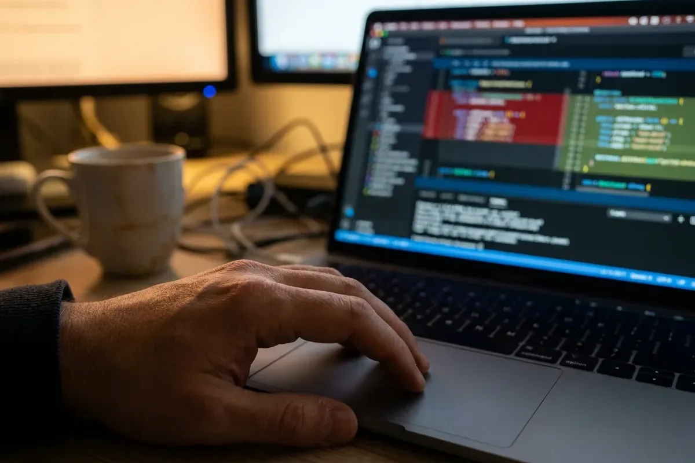
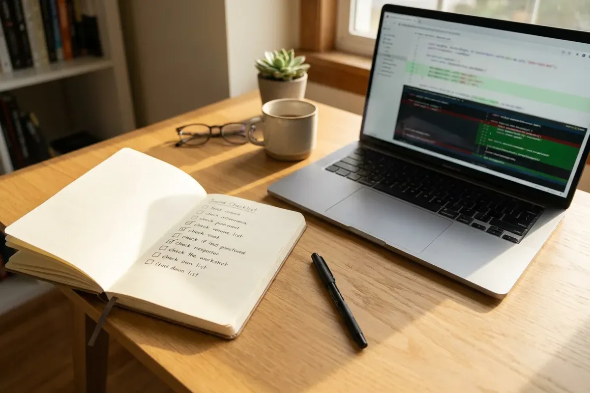

Si alguna vez usaste una herramienta de IA para corregir un bug en el proyecto de otra persona y abriste un pull request, probablemente conoces la sensación: funcionó, las pruebas pasaron y llevó diez minutos. Ahora mira desde el otro lado de la pantalla. Un mantenedor, casi siempre sin recibir nada por ello, abre su bandeja de entrada y encuentra el décimo quinto pull request escrito por IA de la semana, la mayoría equivocados con mucha seguridad.

Ese segundo punto de vista es el motivo por el que varios proyectos conocidos están cambiando las reglas. La tendencia ya ganó hasta un nombre: "AI Slopageddon", un término usado por la analista de RedMonk Kate Holterhoff para la avalancha de contribuciones generadas por IA que los mantenedores no logran seguir.

Este artículo muestra qué está pasando, por qué importa aunque contribuyas solo de vez en cuando y trae una checklist para usar IA en open source sin convertirte en el problema.

## Qué están haciendo los mantenedores

Según el [reportaje de InfoQ sobre el tema](https://www.infoq.com/news/2026/02/ai-floods-close-projects/), las respuestas hasta ahora no son sutiles:

- **cURL** cerró su programa de bug bounty en enero de 2026. El mantenedor Daniel Stenberg llevaba seis años al frente del programa y pagó cerca de US$ 86 mil en total. En 2025, aproximadamente el 20% de los envíos eran generados por IA, y la tasa de informes válidos había caído a cerca del 5%.
- **Ghostty**, el emulador de terminal, pasó a prohibir el código generado por IA enviado sin aprobación previa. Su creador, Mitchell Hashimoto, dejó claro que la regla no es contra la IA en sí. En sus palabras: "This is not an anti-AI stance. This is an anti-idiot stance." (en traducción libre: "Esto no es estar contra la IA. Es estar contra quien no piensa.")
- **tldraw** configuró el repositorio para cerrar automáticamente todos los pull requests externos. Su creador, Steve Ruiz, descubrió que sus propios scripts de IA generaban issues mal escritos, que a su vez atraían PR alucinados en un círculo vicioso.
- **Gentoo Linux y NetBSD** fueron más lejos y prohibieron por completo las contribuciones de IA.

Fíjate en lo que tienen en común estos casos. Ningún mantenedor dice que el código hecho con ayuda de IA sea malo por naturaleza. Reaccionan al volumen y a la falta de esfuerzo. Generar un pull request hoy cuesta casi nada para quien contribuye, pero revisarlo sigue costando tiempo real para el mantenedor, y ese desequilibrio es lo que está rompiendo el sistema.

## Por qué esto te importa aunque no seas mantenedor

Para quien está empezando, el open source suele ser el primer portafolio público. Quien busca el primer empleo o la primera práctica en tecnología escucha el consejo de "contribuye a proyectos abiertos", y es común que ese movimiento se caliente en octubre, con eventos como Hacktoberfest, que animan a nuevos contribuidores a abrir PR. Pero un PR hecho a las apuradas con IA puede quemarte justo en los proyectos en los que querías ser reconocido.

Dos motivos para prestar atención:

1. **Las reglas están cambiando bajo tus pies.** Las guías de contribución que no decían nada sobre IA hace un año hoy pueden exigir una declaración de uso, aprobación previa o prohibir todo. Un PR que habría sido bienvenido en 2024 puede bloquearte hoy.
2. **La primera impresión cuenta.** Un PR cerrado y marcado como spam en un proyecto que admiras es un pésimo comienzo, y los mantenedores recuerdan los nombres.

Existe además una barrera que conoce bien quien no tiene el inglés como lengua materna: casi todo `CONTRIBUTING.md` está escrito en inglés. La tentación de pegar el texto en una IA, pedir una descripción "bonita" y enviarla sin revisar es grande, y es exactamente el tipo de PR genérico que los mantenedores aprenden a reconocer desde la primera línea. Escribir en un inglés simple y propio vale más que un texto pulido que no puedes defender.

## Cómo aparece un PR "slop" en la práctica

Los mantenedores describen los mismos patrones todo el tiempo. Si tu contribución tiene alguno de estos, espera que se cierre:

- **Corrección de un problema que nadie reportó.** La IA encontró algo que parecía un bug y lo "arregló", sin un issue vinculado y sin conversación previa.
- **Descripción que no coincide con el diff.** El texto del PR es pulido y genérico, pero el código cambia otra cosa, o mucho más de lo descrito.
- **Una limpieza enorme y sin relación.** Reformateo, variables renombradas y "mejoras" mezcladas con el cambio real.
- **Código que el autor no sabe explicar.** La primera pregunta de la revisión recibe una respuesta vaga, o el mismo texto con aspecto de pegado.
- **Pruebas que no prueban nada.** Pasan porque afirman lo que el código ya hace, y no lo que debería hacer.
- **Un reporte de bug inventado.** Un informe de bug o de seguridad que describe un comportamiento que no existe, exactamente lo que ahogó el programa de bounty de cURL.

## Checklist de 7 pasos para usar IA en open source

Este es el proceso que mantiene a la IA en el papel de herramienta, y no de cañón de spam. Pasa por él antes de hacer clic en "Create pull request".

### 1. Lee primero las reglas de contribución

Abre el `CONTRIBUTING.md` y busca cualquier mención de IA, LLM o código "generado". Si el proyecto lo prohíbe o lo restringe, el asunto está cerrado. No lo discutas ni intentes esconderlo. Elige otro proyecto o contribuye de una forma permitida, como la clasificación de issues o la mejora de la documentación hecha a mano.

### 2. Empieza desde un issue existente

Busca un issue que ya haya sido reconocido por un mantenedor, de preferencia con etiquetas como "good first issue" o "help wanted". Si no hay, abre una discusión antes y pregunta si el cambio es deseado. Un comentario como "Quiero trabajar en esto, ¿puede ser?" cuesta treinta segundos y evita una revisión desperdiciada.

### 3. Reproduce el problema tú mismo

Antes de pedirle una corrección a la IA, ejecuta el proyecto y ve el bug con tus propios ojos. Si no puedes reproducirlo, no puedes verificar la corrección, y esa es la línea entre una contribución y una conjetura.

### 4. Mantén el cambio del tamaño del problema

Dile a la IA que toque solo lo necesario:

  

    
    ejemplo
    <button class="copy-btn" data-copy-target="minimal-prompt">Copiar</button>
  

  <pre id="minimal-prompt"><code>Corrige solo el bug descrito abajo, con el menor cambio posible.
No reformatees código, no renombres nada y no refactorices partes
no relacionadas. Sigue exactamente el estilo de código ya usado
en este archivo.

Después de la corrección, lista cada archivo y línea que modificaste
y explica por qué cada cambio es necesario. Si no estás seguro de
que la causa raíz es la que describí, dilo en lugar de adivinar.

[pega el texto del issue y el archivo relevante]</code></pre>

La última frase importa. Darle al modelo permiso para decir "no estoy seguro" reduce las respuestas seguras y equivocadas, que forman la mayor parte del slop.

### 5. Lee tu propio diff como un revisor

Abre el diff y lee cada línea como si la hubiera escrito otra persona. Si hay una línea que no puedes explicar, pídele a la IA que la explique y comprueba la explicación en la documentación, o borra la línea. Debes poder defender cada cambio en una revisión de código sin pegar nada de vuelta en un chat.

### 6. Ejecuta las pruebas reales del proyecto y añade una que falle antes

Ejecuta localmente la suite de pruebas existente. Si vas a añadir una prueba, confirma que falla sin tu corrección y pasa con ella. Una prueba que pasa en los dos casos no demuestra nada.

### 7. Escribe tú mismo la descripción y declara el uso de IA

Escribe la descripción del pull request con tus palabras: cuál era el problema, cómo lo reprodujiste, qué cambió y cómo lo probaste. Cuando el proyecto lo pida, o incluso cuando no lo pida, incluye una línea como "Usé un asistente de IA para redactar la corrección y lo revisé y probé todo yo mismo." Ser transparente genera confianza. Que te descubran ocultándolo la destruye.

## Para mantenedores: defensas que no exigen un bloqueo

Si mantienes un proyecto y te estás ahogando, cerrar las contribuciones no es la única salida. Con base en lo que ya intentaron los proyectos afectados, vale la pena considerar medidas más suaves:

- **Exigir un issue vinculado y aprobado** antes de abrir un pull request.
- **Poner una política de IA en el `CONTRIBUTING.md`.** Di con claridad qué se permite, qué exige declaración y qué se cerrará.
- **Usar una plantilla de PR con una casilla de confirmación** de que el contribuidor reprodujo el problema y ejecutó las pruebas.
- **Pedir el razonamiento.** Una pregunta como "¿por qué elegiste este enfoque en lugar del helper que ya existe?" filtra rápidamente la mayor parte del contenido sin revisar.

La historia de tldraw sirve también de alerta. Si automatizas la creación o la clasificación de issues con IA, revisa lo que produce, porque los issues mal generados atraen PR mal generados.

## Qué llevarte de aquí

La IA no volvió malas las contribuciones al open source. Las volvió baratas de producir, y el costo de revisarlas no bajó con ellas. Los contribuidores que van a seguir siendo bienvenidos son los que tratan la IA como una forma de trabajar más rápido en un problema que entienden, y no como una forma de saltarse el entendimiento.

Si te quedas con una sola cosa: la IA puede escribir el código, pero quien tiene que responder por él eres tú.

*Fuente de los cambios de política de los mantenedores y de las cifras: [InfoQ, "AI 'Vibe Coding' Threatens Open Source as Maintainers Face Crisis".](https://www.infoq.com/news/2026/02/ai-floods-close-projects/)*
